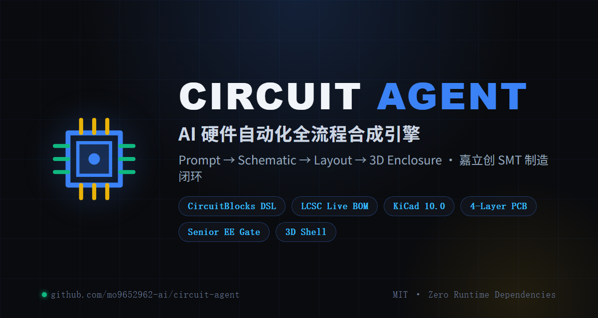

<p align="center">
  
</p>

# CircuitAgent · Community Edition

<!-- mcp-name: io.github.mo9652962-ai/circuit-agent-client -->

**Prompt → Schematic → Layout → 3D Enclosure → Fabrication Bundle**

<p align="center">
  <a href="https://mo9652962-ai.github.io/circuit-agent/"></a>
  <a href="https://github.com/mo9652962-ai/circuit-agent/actions/workflows/ci.yml"></a>
  <a href="LICENSE"></a>
  <a href="https://www.python.org/downloads/"></a>
  <a href="tests/"></a>
  <a href="https://github.com/mo9652962-ai/circuit-agent/releases"></a>
  <a href="https://github.com/modelcontextprotocol/registry"></a>
  
</p>

<p align="center">
  <a href="https://mo9652962-ai.github.io/circuit-agent/"><b>🌐 在线 EDA 工作台 / Live Demo</b></a>
  ·
  <a href="README.md"><b>🇨🇳 中文说明</b></a>
  ·
  <a href="README_EN.md"><b>🇬🇧 English</b></a>
  ·
  <a href="#-mcp-server-接入">🔌 MCP Server</a>
  ·
  <a href="#-支持的电路积木清单">🧩 19+ 积木清单</a>
  ·
  <a href="#-工业-dfx-制造审查与安全仿真">🏭 工业 DFX</a>
  ·
  <a href="#-eda--制造数据导出">📐 KiCad/BOM 导出</a>
  ·
  <a href="https://github.com/mo9652962-ai/circuit-agent/issues">💬 反馈</a>
</p>

> **Status: alpha.** This repository is the open community layer of CircuitAgent: the
> hardware DSL, the LCSC live-selection client, and the data contracts that the
> full compiler consumes. The block set is deliberately small and every block is
> unit-tested — correctness over coverage.

---

## 为什么需要这一层 (Why this layer exists)

让大语言模型直接生成底层走线、焊盘与封装，几乎必然产出非法几何或引脚短路。
CircuitAgent 的做法是把 LLM 的输出**约束在预验证的电路积木上**，再用 Pydantic
契约把它变成确定性网表 —— 模型只负责"选积木"，不负责"画线"。

<p align="center">
  
</p>

```text
Natural language prompt
        │
        ▼
┌────────────────────────┐
│  CircuitBlocks DSL     │  keyword → audited sub-circuits (deterministic)
└────────────────────────┘
        │
        ▼
┌────────────────────────┐
│  Netlist contract      │  Pydantic / JSON Schema (SSOT)
└────────────────────────┘
        │
   ┌────┴─────┐
   ▼          ▼
┌────────┐ ┌──────────────────┐
│ LCSC   │ │ REST / MCP APIs  │
│ client │ │ (community layer)│
└────────┘ └──────────────────┘
```

---

## 快速上手 (Quick Start)

**方式 A · 从 PyPI 安装（推荐）**

```bash
pip install circuit-agent-client
```

**方式 B · 从源码使用**

```bash
git clone https://github.com/mo9652962-ai/circuit-agent.git
cd circuit-agent
```

**零运行时依赖** —— 纯 Python 标准库实现，装完即用，不拉任何第三方包。
跑测试才需要 dev extra：`pip install -e ".[dev]"`

### 1 · 一句话生成硬件网表

```python
from client.synthesizer import synthesize_from_prompt

spec = synthesize_from_prompt(
    "基于 ESP32-C3 的环境监测节点，带 Type-C 供电、I2C 传感器插座、指示灯和2个按键"
)

print(spec["chip_id"])                            # ESP32-C3
print(len(spec["modules"]))                       # 元器件数
print(spec["netlist"]["connections"][0])          # 第一条网络连接
print(spec["unmatched"])                          # 你要求了、但 DSL 还不支持的模块（可执行信号）
print(spec["not_requested"])                      # 你没提到的可选模块（仅参考，非能力缺口）
```

映射是**确定性的**：同一句话永远产出逐字节相同的结果（CI 中有对应断言）。

`unmatched` 与 `not_requested` 是两个**刻意分开**的信号，不要混用：

| 字段 | 含义 | 例子 | 消费方式 |
|:---|:---|:---|:---|
| `unmatched` | 你**明确要求**、但当前 DSL **造不出来** | `ethernet` / `relay` / `motor_driver` | 这是能力信号，agent 应据此告知用户或换方案 |
| `not_requested` | 可选积木，只是这句话**没提到** | `button` / `led` / `buzzer` / `i2c` / `crystal` | 纯参考信息，不代表能力缺口 |

**不会被静默丢弃**：任何未识别的意图都会出现在 `unmatched` 里，而不是悄悄消失。

### 2 · 查询立创商城实时库存与单价

```python
from client.lcsc_client import search_lcsc_parts

for part in search_lcsc_parts("CH340N", limit=3):
    print(f"[{part['lcsc_part']}] {part['part_number']} | {part['package']} | "
          f"库存 {part['stock']} | ${part['price_usd']} | {part['part_class']}")
```

```text
[C506813] CH340N | SOP-8_L5.0-W4.0-P1.27-LS6.0-BL | 库存 196 | $0.5537 | Extended Part
```

客户端自带**重试退避 + 硬超时 + 24 小时磁盘缓存 + 防御式解析**：上游改结构不会
抛异常，断网时回落到缓存（缓存也没有则返回空列表，调用方永远不必处理传输层异常）。

### 3 · 直接用积木搭电路

```python
from client.circuit_blocks import block_usb_c_power, block_power_ldo_3v3

blk = block_power_ldo_3v3()
for comp in blk.components:
    print(comp.ref, comp.value, comp.package, comp.lcsc)
```

---

## 积木清单 (Block Catalogue)

| Block | 说明 | 关键设计点 |
|:---|:---|:---|
| `block_usb_c_power` | Type-C 供电输入 | 双 5.1k CC 下拉（sink 角色，非 56k 上拉） |
| `block_power_ldo_3v3` | AMS1117-3.3V 稳压 | 10µF 输入/输出储能电容 |
| `block_crystal_clock` | 无源晶振 + 负载电容 | 标记 `guard_ring` 属性供后端加地屏蔽环 |
| `block_button` | 消抖按键 | 10k 上拉 + 100nF RC，位号可参数化 |
| `block_led` | 状态指示灯 | 限流电阻 + 颜色/阻值可参数化 |
| `block_buzzer` | 蜂鸣器驱动 | S8050 NPN + 1N4148W 反向续流二极管 |
| `block_i2c_header` | I2C 扩展排针 | SCL/SDA 各 4.7k 上拉 |
| `block_rs485_transceiver` | SP3485 半双工差分串口 | 120Ω 终端电阻 + 100nF 去耦 + 3P 排针引出 |
| `block_can_transceiver` | SN65HVD230 3.3V CAN 节点 | 120Ω 终端匹配 + 10k 斜率控制 (高速模式) |
| `block_battery_tp4056` | TP4056 1A 线性锂电充电 | 1.2k 限流 + 充/满双色指示灯 + 2P 电池端子 |
| `block_sensor_aht20` | AHT20 温湿度传感器 | 工业 I2C 总线 + 去耦电容 + DFN-6 封装 (C2757850) |
| `block_sensor_mpu6050` | MPU-6050 6轴 IMU 运动姿态传感器 | 3轴陀螺仪+3轴加速度计 + 旁路去耦 + QFN-24 (C24112) |
| `block_esd_usb_tvs` | USB 接口高速 TVS 静电防护 | USBLC6-2SC6 超低结电容 (0.6pF) + SOT-23-6 |
| `block_esd_rs485_tvs` | RS-485 工业双向非对称 TVS | SM712 工业防雷/抗浪涌防静电二极管 (-7V~+12V) |
| `block_esd_can_tvs` | CAN 总线 ESD 双路 TVS 阵列 | PESD1CAN 24V 车规/工控双线 TVS (SOT-23) |
| `block_reverse_polarity_protection` | 工业电源输入防反接保护 | 肖特基二极管 (SS34) 或 低压降 P-MOSFET (AO3401A) |
| `block_power_pi_filter` | 电源输入 EMI π型 LC/RC 滤波器 | 磁珠 (100MHz 600Ω) + 10µF 钽电容/陶瓷电容吸收纹波 |
| `block_fiducial_marks` | SMT 贴片光学定位点 (Mark点) | 3个 1.0mm 裸铜焊盘 + 2.0mm 阻焊开窗 (DFA工序必备) |
| `block_testpoint_matrix` | 自动化测试点矩阵 (Test Points) | 1.0mm SMD 测试铜焊盘 (支持电源轨、地轨、SWD、UART测试) |
| `block_watchdog_supervisor` | TPS3823 看门狗/复位监控 | 1.6s WDI 喂狗 + 推挽复位输出（工业 MCU 防跑飞，IEC 61508 实践） |
| `block_ethernet_phy_w5500` | W5500 SPI 硬件 TCP/IP 以太网 | 10/100M PHY + 集成变压器与状态灯 RJ45 (HR911105A) + 25MHz 晶振 |
| `block_isolated_adc_ina219` | INA219 I2C 功率/电流双向监测 | 0.1Ω 2W 1% 精密检流电阻 + 实时电压电流遥测 |
| `block_motor_driver_drv8825` | DRV8825 2.5A 45V 步进电机驱动 | 1/32 微步进 + 100µF 50V 母线高压滤波 + XH-4P 接口 |
| `block_optocoupler_isolated_io` | PC817 5kV 高压光电隔离输入 | 2.4k 限流 + 反向保护二极管，适配 24V PLC 工业自动化输入 |

每个积木的引脚号、LCSC 料号、封装名在冻结前均对照数据手册与立创商城列表核验过。
`tests/test_circuit_blocks.py` 会强制校验：位号唯一、每个元件都有封装与料号、
网络端点必须指向已声明的元件、每个积木都必须接 `/GND`。

---

## MCP Server (AI Agent 工具服务)

CircuitAgent 内置标准 JSON-RPC 2.0 stdio MCP Server，基于纯 Python 标准库构建（无需任何第三方 pip 库），可无缝接入 **Claude Desktop**、**Cursor** 或 **Windsurf**。

当前暴露 **65 个工具**、8 个资源（`circuit://` URI）与 4 个工程提示词（slash-command）。

### 协议版本：MCP `2026-07-28`

服务器实现 **2026-07-28 无状态协议核心**，同时向后兼容到 `2024-11-05` 的握手客户端：

| 能力 | 实现 |
|:---|:---|
| `server/discover` | ✅ 强制方法，一次交互返回支持版本/能力/身份，也是 stdio 的向后兼容探针 |
| 无握手请求 | ✅ 每个请求在 `params._meta` 自描述协议版本与客户端能力，无 `initialize` 也能工作 |
| `resultType` | ✅ 所有结果携带 `"complete"`（或 `"input_required"`），旧客户端可安全忽略 |
| 缓存提示 | ✅ `tools/list` / `resources/list` / `prompts/list` 返回 `ttlMs` + `cacheScope` |
| 确定性顺序 | ✅ 工具目录顺序稳定，客户端与上游 prompt 缓存可命中 |
| 错误码分配 | ✅ 使用规范保留区 `-32020`~`-32099`；资源未找到改为 `-32602` |
| 旧版握手 | ✅ `initialize` 保留并协商版本，不断掉 2026 年前的客户端 |
| **结构化输出** | ✅ 双通道：`content` 给模型读、`structuredContent` 给程序读，两者语义严格等价；6 个电气工具声明 `outputSchema` |

### 双通道输出

MCP 2026-07-28 规定 `tools/call` 有两个输出通道，且**同时存在时语义必须等价**：

- `content` — 面向模型。语言模型只读得到这一段，token 成本与可读性优先。
- `structuredContent` — 面向程序。给代码生成、类型化编排与 `outputSchema` 严格校验用。

本服务器的做法是**从同一份文档派生**：工具已经返回 JSON，结构化通道由解析该文档得到，
因此两个通道不可能不一致（有测试对全部工具断言这一点）。返回文件内容的导出工具
（KiCad 网表、Gerber、IPC-2581、BOM CSV）与返回 ASCII 图的工具不声明 `outputSchema` ——
它们产出的是文档不是数据对象，给它写 schema 只会描述一个字符串容器。错误结果同样不带
结构化负载：失败的调用没有符合 schema 的文档，编造一个错误对象形状是没人要求的契约。

`server/discover` 的 `instructions` 字段直接写给 LLM 看：先 `synthesize_circuit` 出网表，再 `run_erc` 门禁，
然后 `audit_industrial_dfx` 与 `validate_manufacturing_package`，最后才导出。`calculate_*` / `analyze_*`
全是纯函数（无网络、无状态），可放心试探；只有 `search_lcsc_parts` 联网且免 Key。

### 运行方式
```bash
python -m client.mcp_server
```

### Claude Desktop 配置 (`claude_desktop_config.json`)
```json
{
  "mcpServers": {
    "circuit-agent": {
      "command": "python",
      "args": ["-m", "client.mcp_server"],
      "cwd": "/path/to/circuit-agent"
    }
  }
}
```

### 暴露的工具 (Tools)
1. `synthesize_circuit`: 输入自然语言，输出确定性硬件网表与积木清单。
2. `search_lcsc_parts`: 免 Key 实时查询立创商城的元器件库存、封装、阶梯单价与基础库/扩展库属性。
3. `list_circuit_blocks`: 列出 DSL 中全部可用的 24 大已审计电路积木规格。
4. `validate_netlist`: 根据正式 JSON Schema 校验网表数据结构合法性。
5. `calculate_trace_impedance`: 基于 IPC-2141 解析公式计算微带线与差分对走线阻抗（50Ω RF / 90Ω USB / 120Ω CAN/485）。
6. `calculate_bom_cost`: PCBA 成本核算器，自动精算元器件裸成本与嘉立创扩展库换料费（¥20/种）。
7. `list_supported_chips`: 查询当前支持的微控制器型号及其引脚分配硬规则。
8. `register_custom_chip`: 动态注册第三方 MCU 物理引脚约束与外设映射表。
9. `calculate_ipc2152_trace_current`: 依据 IPC-2152 标准精确计算印制导线载流能力或反算线宽（温升 ΔT、铜厚 1oz/2oz、内层降额）。
10. `audit_industrial_dfx`: 工业级 DFX (DFM/DFA/DFT/DFC) 与生产合规自动化静态审查器，输出打分评级、问题分类与 Markdown 体检报告。
11. `export_kicad_netlist`: 导出标准 KiCad S-Expression 网表 (.net)，支持 KiCad 6/7/8/9/10 直接导入 Pcbnew 快速布线。
12. `export_manufacturing_bom`: 生成量产级嘉立创 SMT BOM CSV 表格（含位号聚合、基础库免换料费分类）。
12b. `export_manufacturing_cpl`: 生成嘉立创 SMT 贴片坐标文件（CPL/pos，位号 + 中心坐标 + 层 + 旋转角）。BOM 与 CPL 必须成对交付——只在 BOM 里而不在 CPL 里的器件会被采购但不会贴装，故障留到功能测试才暴露。
13. `calculate_parametric_circuit`: 闭环参数化硬件设计方程（E96 标准分压电阻对求解、LDO 散热结温校核、I2C 上拉阻值及 RC 滤波）。
14. `render_circuit_topology`: 生成结构化 ASCII 系统架构拓扑图（电源轨、总线、传感器与保护子系统）。
15. `run_erc`: 网表级电气规则门禁（ERC）——悬空网络、缺 GND、未知位号、缺电源域、缺去耦电容、差分总线缺 120Ω 终端电阻、电容真实有效容值不足等 45+ 条规则，每条带 severity 与出处，blocking/error 阻断 BOM/CPL 交付。其中 `MLCC_EFFECTIVE_CAPACITANCE_DEFICIT` 会用真实降额模型复算每颗电容在额定偏置下的实际容值，跌破标称 60% 即告警；器件未带偏置数据时保持沉默而不编造。`DECOUPLING_PER_IC_DEFICIT` 按**器件数量**而非网络判断去耦是否充足——三颗 IC 共用一颗 100nF 会被拦下，因为共用意味着远端器件的瞬态电流要穿过走线电感。`COMPONENT_RATING_INSUFFICIENT` 从电源轨名解析电压（`/+3.3V`、`/VMOT_24V`、`/VBUS`），与器件声明的额定值比对，6.3V 电容接在 24V 轨上直接判 error；未声明额定值的器件跳过而不猜测。
16. `analyze_power_tree`: 系统级电源树与热功耗分析器，追踪电源域负载电流、LDO 压差裕量、热耗散与结温估算 ($T_j$)。
17. `calculate_ipc2221_clearance`: 基于 IPC-2221B Table 6-1 标准根据工作电压与导体类别 (B1内层/B2外层裸露/B4涂覆/A6引脚) 精确计算最小电气间隙。
18. `export_specctra_dsn`: 生成通用 Specctra DSN (v15.0) 自动布线交互文件与启发式器件自动布局，支持直接送入 Freerouting / KiCad 执行 100% 自动化走线。
19. `export_kicad_schematic`: 导出原生现代 KiCad 8/9 S-Expression 原理图文件 (.kicad_sch)，支持在 Eeschema 中直接以可视化原理图打开编辑（含器件符号排布、属性及图框）。
20. `audit_supply_chain`: 供应链多源弹性审计器（ISO 9001 采购供应链审计），自动排查单源卡脖子器件并映射引脚完全兼容的第二货源替代料 (Drop-in Second-Source) 与立创商城编号。
21. `calculate_differential_skew`: 高速差分对等长与时延差约束求解器（USB 2.0 HS ≤10ps、以太网 ≤25ps、CAN-FD ≤50ps），反求目标等长差与蛇形绕线 (Serpentine tuning) 齿数与几何尺寸。
22. `export_ipc_d356`: 导出通用工业标准 IPC-D-356A 裸板电性能飞针测试网表文件，直接喂入板厂飞针测试机 (AEMG/ATG/MicroCraft) 执行开短路连通性检验。
23. `export_gerber_bundle`: 原生直出符合 Ucamco RS-274X 扩展标准的制造级 Gerber 打包文件（板框 .gm1、顶层铜皮 .gtl、阻焊开窗 .gts、顶层丝印 .gto），摆脱对图形化 EDA 鼠标导出的依赖。
24. `calculate_pcb_stackup_impedance`: 标准工业四层板 (JLC04161H) 与六层板 (JLC06161H) 叠层矩阵查询与 IPC-2141A 特征阻抗自动反求（50Ω RF微带线、90Ω USB、100Ω 以太网、120Ω 工业差分对）。
25. `export_excellon_drill`: 生成生产级 IPC-NC-349 Excellon CNC 数控钻孔文件 (.drl)，补齐 PCB 制造 5 层生产包。
26. `generate_interactive_bom`: 生成量产首件检验交互式装配导航网页 (iBOM, InteractiveHtmlBom 对标)，实现位号清单与 SVG 矢量板图双向高亮聚焦。
27. `calculate_smt_feeder_matrix`: SMT 贴片机料槽与吸嘴智能配置器，遵循 EIA-481 载带标准（8/12/16/24mm 宽度与 2/4/8/12mm 步距）与 Juki/Yamaha 吸嘴矩阵（502~506 规格）。
28. `export_openpnp_job`: 导出标准 OpenPnP 自动化贴片作业文件与工业贴片机 CSV，包含吸嘴配置、料槽站位号、中心坐标与器件旋转角。
29. `calculate_ipc7351_land_pattern`: 依据 IPC-7351B 国际标准计算表面贴装元件焊盘几何与 Courtyard 边界（焊脚延伸 Toe、内侧延伸 Heel、侧边延伸 Side、RMS 统计公差，覆盖 A/B/C 三级焊盘密度）。
30. `calculate_pcb_panel_rails`: SMT 自动化产线拼版工艺边与邮票孔/V-cut 计算器，依据 IPC-2221B 与 IPC-SMEMA-9851 自动化导轨规范生成 3.2mm 定位孔、光学定位点与材料利用率。
31. `calculate_ict_testpoints`: 分析 PCB 网表测试可测性并规划针床在线测试 (ICT) 测试焊盘矩阵 (B.Cu Φ1.0mm/2.54mm 网格)，根据 IPC-9252 与 IPC-2221B 智能分配探针类型 (皇冠型/尖矛型/锯齿型) 与故障覆盖率统计。
32. `calculate_bga_escape_routing`: 依据 IPC-7095 标准求解 BGA 封装对角 45° 狗骨头 (Dogbone) 引脚逃孔扇出几何、通道线宽与线距，并反推最少信号走线层数与 HDI 微孔需求。
33. `calculate_teardrop_reinforcement`: 计算导线连接过孔/焊盘处的切线圆弧与锥形泪滴 (Teardrop) 补强几何，消除热应力开裂并确保满足 IPC-2221B Section 9.1.5 与 IPC-A-600J Class 3 破孔零开路规范。
34. `calculate_copper_thieving_balance`: 依据 IPC-2221B Section 10.1.1 评估顶底层铺铜覆盖率平衡度，预警回流焊弓曲/扭曲变形风险 (IPC-TM-650 2.4.22 ≤0.75%)，并在孤立空白区自动生成网格/阵列假铜平衡点 (Copper Thieving)。
35. `calculate_via_stitching_array`: 依据 IPC-7093 Section 7.2 规划 QFN/功率芯片裸露散热焊盘底部的导热过孔阵列 (Φ0.3mm/1.2mm 网格)，或依据 IPC-2141A 生成高频 RF 微带线双侧屏蔽地孔栅栏 (Shielding Fence)。
36. `calculate_serpentine_tuning_geometry`: 依据 IPC-2141A 高速传输线标准生成差分对蛇形等长绕线微调几何路径，严格保障线距自耦合抑制约束 ($S \ge 3W, H \ge 3W$)。
37. `calculate_stencil_aperture_ratios`: 依据 IPC-7525 钢网设计规范逐开孔核算面积比 (AR ≥ 0.66) 与宽厚比 (≥ 1.5)，定位锡膏释放不足的高危细间距开孔，预防立碑/虚焊/BGA 枕头效应。
38. `calculate_fiducial_layout`: 依据 IPC-2221B Section 12 与 JEDEC J-STD-020 生成非对称 L 形 3 点全局光学定位点布局 (消除 180° 旋转歧义)，并为 ≤0.5mm 细间距器件自动布置对角局部基准点。
39. `calculate_via_protection_plan`: 依据 IPC-4761 按过孔装配场景选型保护结构 (Type I~VII)：BGA 盘中孔强制 Type VII 填孔+电镀盖帽 (VIPPO) 防渗锡，热沉焊盘 Type V 填孔，BGA 通道 Type IV，开阔区 Type II。
40. `calculate_solder_paste_volume`: 依据 IPC-7525A 锡膏转移分析逐开孔核算沉积锡膏体积比 (合规窗口 1.0~2.5)，预警焊料饥饿 (开路/立碑/枕头效应) 与锡膏过量 (桥连/锡珠) 缺陷。
41. `export_ipc2581`: 导出简化合规的 IPC-2581B 单文件智能制造数据包 (XML)——叠层、BOM、已布局元件、网络引脚归属与板框轮廓，取代传统 Gerber+Excellon+TXT 交付包，直接对接 Siemens X / Altium / Zuken 与大型 EMS 代工厂报价投产。
42. `export_assembly_drawing_svg`: 依据 ASME Y14.5 与 IPC-2221B Section 11 生成 1:1 比例 PCBA 装配图 SVG——元件外框与位号标注、极性标识 (IC 第一脚圆点/二极管阴极条/电解电容正极框)、底视图 X 镜像、ASME Y14.100 标题栏 (版本/比例/审核签署栏)。
43. `diff_netlists`: 网表 ECO 比对引擎——对改版前后两版网表输出元件增删、值/封装变更、网络增删、引脚归属迁移与变更等级 (NONE/MINOR/MAJOR)，支撑 PLM 工程变更 (ECO) 流程向制造/采购/测试部门准确传递改版差异。
44. `generate_assembly_process_plan`: 混装装配工艺路线规划器——依据 IPC-A-610G Section 7 将每个器件分配至 SMD 回流 / THT 波峰 / THT 手工 / 机械装配工序，输出 EMS 十段标准工艺路线 (SPI → 回流 → AOI → 插件 → 波峰/选择焊 → 手工补焊 → ICT → FCT → 三防 → 包装)。
45. `optimize_panel_grid`: 拼版网格利用率优化器——枚举 grid_x × grid_y、工艺边布局与分板方式 (V-cut/邮票孔) 组合，过滤超出板厂上限 (默认 300×300mm) 的方案，按基材利用率降序输出 Top-10 可行拼版方案。
46. `calculate_fab_cost`: PCB 制造费用估算器——按板厂公开阶梯计价 (2/4/6 层 × 5/10/30/100 件数量档、超 100×100mm 面积加收、阻焊颜色/表面工艺 HASL·ENIG·OSP/板厚/交期加急系数) 输出总价与单价估算。
47. `calculate_smt_placement_clearance`: SMT 贴片机吸嘴碰撞与高器件净空分析器——分析 H ≥ 4.0mm 高大器件与相邻矮件 (0402/0603) 的吸嘴下压净空禁布区 (≥ 2.0mm)，按由矮到高输出分层贴装优先级序列 (IPC-SM-782 / OpenPnP)。
48. `calculate_creepage_isolation_slot`: 高压安规防爬电隔离铣槽计算器——依据 IPC-2221B Table 6-1 与 IEC 62368-1 评估高低压导体表面间距，当爬电距离不足时自动规划贯通空气隔离铣槽 (端点/槽宽/绕行等效爬电扩展)。
49. `analyze_impedance_tolerance`: 多层板特征阻抗制造公差与灵敏度分析器——对标 Polar SI9000 模型评估介质厚度 (±10%)、线宽 (±10%)、铜厚 (±15%)、Er (±5%) 公差叠加下的 Zmin/Zmax 与偏导灵敏度，核准 ±10% 目标容限合格率。
50. `evaluate_material_cti_creepage`: 基材相对漏电起痕指数 CTI 与安规爬电评定器——依据 IEC 62368-1 Table 25 与 IPC-2221B 划分材料组别 (Group I ≥600V 至 Group IIIb)，在污染等级 1/2/3 下核算爬电安全裕量并给出高 CTI 基材升级建议。
51. `calculate_wave_solder_orientation_audit`: SMT 底面元件波峰焊排布朝向角与阴影效应审计器——依据 IPC-7351B Section 3.1.4 与 SMTA 规范审计片式无源件垂直于波峰流向 (防立碑虚焊)、SOIC 芯片平行于流向 (防密集引脚连锡桥连)、以及高器件下风向 3xH 阴影禁布区。
52. `calculate_press_fit_hole_compliance`: 汽车与工业无焊压接鱼眼端子过孔合规分析器——依据 IPC-9797 与 IEC 60352-5 标准核准无焊压接引脚成品孔径 (标准 0.94mm~1.09mm) 与孔壁铜厚 (≥25μm)，估算压入力与保持力防孔壁分层与振动脱落。
53. `audit_fab_capabilities`: PCB 制造厂工艺极限能力核查器——对接 JLCPCB (标准/高精阶梯)、PCBWay、OSH Park 实际产线工艺能力库，严格核查最小线宽/线距、最小过孔钻孔/焊盘环宽、板厚纵横比 (Aspect Ratio) 与最小铣槽槽宽，防止工程确认 (EQ) 拒单与返修。
54. `validate_manufacturing_package`: 无头自动化制造交付包完整性与防篡改核验器——自动化核查 5 层基础 Gerber、Excellon 数控钻孔、BOM 物料清单与 CPL 贴片坐标文件的完整性与非空状态，校验位号一致性并自动生成全包 SHA-256 防篡改验签总账，支撑 CI/CD 无人值守发布流水线。
55. `audit_ipc6012_class_compliance`: 刚性印制板 IPC-6012E 与 IPC-A-600J Class 1/2/3 验收准则审计器——逐项核查外层与内层焊盘环宽、Class 3 严苛零破出 (0° breakout) 硬门禁、通孔孔壁平均电镀铜厚 (Class 3 ≥25μm) 与最薄点铜厚、蚀刻线宽蚀损率以及阻焊桥绿油桥宽，生成军工/医疗/汽车电子可靠性合规报告。
56. `optimize_smt_feeder_setup`: 工业 SMT 贴片机飞达供料器料车排产优化器——基于松下 NPM / 富士 NXT / 西门子 ASM 标准 80 槽料车，应用成组技术 (GT) 规划常驻通用料块 (100nF、10k 免换线固定料槽)、按贴装频次将高密度物料聚合于悬臂中心以最小化龙门行进时间，并预测各料卷接料耗尽瓶颈 (IPC-9851)。
57. `calculate_copper_pour_current_drop`: 大面积多边形覆铜与电源铜排直流压降与电流密度分析器——依据 IPC-2152 Section 5.0 与 IEC 60092-352 计算复杂几何多边形覆铜的方块电阻、直流内阻、IR 压降与焦耳热耗，校核过孔阵列/开槽颈缩区的电流密度上限 (≤35.0 A/mm²)，防止高载流大功率电源板铜箔碳化起泡分层。
58. `audit_component_msl_floor_life`: 贴片器件潮湿敏感度等级 (MSL) 开袋车间暴露寿命与除湿烘烤方案审计器——依据 JEDEC J-STD-033D 与 IPC-M-109 规范跟踪高密度塑封芯片 (BGA/QFN/CSP/TQFP) 在产线环境温湿度下的暴露时间，精准识别超期芯片并生成标准化烘烤工单 (125°C 高温或 40°C 低湿干燥)，从源头杜绝 260°C 回流焊“爆米花”开裂分层。
59. `calculate_effective_capacitance`: MLCC 真实工作容值求解器——**标签值不是电路里的值**。按直流偏置 (主导项，额定电压下普遍损失 35~65%，小封装更差)、交流信号幅度、温度系数、对数老化四大机制连乘降额，再叠加器件容差，输出完整因子栈便于定位最大杀手。Class I (C0G/NP0) 正确短路为仅容差。可传入数据手册实测保留率 (Murata SimSurfing / TDK SEAT) 替换区间估计并标记 `confidence="measured"`。
60. `size_hold_up_capacitor`: 掉电保持 (Brown-out Ride-through) 储能电容求解器——以**有效容值**而非标签值解 C = I·t/ΔV，再除以窗口内最差偏置点的保留率，给出实际必须采购的标签容值。同时报告达成保持时间、缺口与所需标签值。按标签值选型就是「设计通过、实测 0.85ms 掉电」的根因。
61. `analyze_rc_filter_effective`: RC 滤波器有效截止频率分析器——用器件实际容值而非标签值计算截止频率。标称 1kHz 的滤波器若用偏置下只剩 40% 容值的 X5R，实际截止在 2.5kHz。输出标称/实际截止、漂移百分比与成因，并显式区分工况降额与器件容差两个独立误差源。
62. `analyze_divider_tolerance`: 分压器容差带分析器——**标称值不是规格书**。同时给出精确最差情况 (四角枚举，因传输函数对每个电阻单调故为精确解) 与真实统计带 (一阶灵敏度传播)。关键点：分压输出是两个随机变量的商，**不能**直接对百分比容差做 RSS (TI SNVA112 明确指出)，必须先用解析偏导转成电压贡献再 RSS。含 TCR、按 √时间 缩放的老化漂移、电源容差与配对电阻比值容差，并指出哪个电阻主导误差预算。
63. `analyze_resistor_error_budget`: 单只电阻寿命末期阻值带分析器——四项误差模型 (值容差 + 温度系数 + 寿命漂移 + 配对网络比值容差)。同时给出 RSS 带与线性最差带，并指出主导项：买 ±0.1% 厚膜电阻去修精度问题往往无效，因为其 200ppm/°C 的 TCR 在 60°C 温漂下已贡献 1.2%。寿命漂移按时间比的平方根缩放 (随机游走，不是斜坡)。
64. `solve_feedback_divider`: 反馈分压电阻对精确求解器——给定稳压器/比较器目标输出与基准电压，求 R1/R2 并报告 E96 取整带来的静态误差。理想电阻对几乎从不存在于 E96 序列中，该取整误差是**系统性偏差而非容差**：每块板都一样的偏，必须与容差带分开预算。

### 暴露的资源 (Resources)
支持通过 `circuit://` URI 直接将规范加载到大模型上下文，无需执行额外工具：
- `circuit://specs/netlist-schema`: 完整的网表 Draft-07 JSON Schema。
- `circuit://specs/cpl-standard`: 嘉立创 SMT 坐标规范与封装偏角补偿表。
- `circuit://specs/ipc-dfx-rules`: IPC-2152 导线载流/温升与 IPC-2221 电气间隙/爬电距离硬规则。
- `circuit://blocks/catalog`: 24 大电路积木的元器件、引脚与网络全量清单。
- `circuit://rules/jlc-smt`: 嘉立创四层板叠层 (JLC04161H) 与生产物理规则。
- `circuit://examples/esp32c3-minimal`: ESP32-C3 极简温湿度节点参考网表。
- `circuit://examples/stm32f103-controller`: STM32F103 工业控制板参考网表。
- `circuit://examples/rp2040-dualcore`: RP2040 双核传感器扩展板参考网表。

### 快捷工程 Prompt (Slash-Commands)
- `/design_hardware_project`: 全流程硬件设计指令（积木匹配 → 阻抗计算 → BOM核算 → 网表校验）。
- `/audit_schematic_netlist`: Senior EE 硬件体检审查指令（去耦电容亲和性、差分对等长、Type-C 下拉阻抗）。
- `/optimize_bom_cost`: PCBA 降本优化指令（分析扩展库物料并推荐免换料费的基础库替代料）。
- `/audit_industrial_compliance`: 工业与量产级 DFX 审查指令（核查 IPC-2152 载流温升、IPC-2221 电气间隙、DFT 测试点覆盖率与 TVS 端口抗浪涌防护）。

---

## 数据契约 (Contracts)

- [`specs/netlist_schema.json`](specs/netlist_schema.json) — 网表 JSON Schema
- [`specs/cpl_standard.md`](specs/cpl_standard.md) — 嘉立创 SMT 坐标规范与封装偏角补偿表
- [`examples/`](examples/) — STM32F103 / ESP32-C3 / RP2040 参考网表，CI 强制校验其符合 Schema

---

## 测试与 CI

```bash
pytest tests/ -q      # 240 passed
```

CI 在 `ubuntu-latest` + `windows-latest` × Python 3.10/3.11/3.12 上跑全量测试，
并额外做两件事：校验 `examples/` 全部符合 Schema、离线跑通 README 里的快速上手命令。

---

## 范围与路线图 (Scope & Roadmap)

**本仓库包含**：硬件 DSL 与积木库、立创实时选型客户端、网表/CPL 数据契约、标准 MCP Server、REST 交互接口。

**暂不包含**：多层板物理布局与布线求解、参数化 3D 壳体布尔几何、Senior EE 物理规则门禁。
这些是上游编译器的高级能力，仍在开发中；本仓库通过稳定的数据契约与客户端接口与其对接，
契约本身是公开且版本化的。

路线图：

- [x] 积木库 + 确定性映射 + 单元测试
- [x] 立创实时选型客户端（重试/缓存/降级）
- [x] JSON Schema + 三份参考样例 + CI
- [x] 工业级实用积木（RS485 / CAN / TP4056 锂电）
- [x] 标准 MCP Server 实现（纯标准库）
- [x] 中英双语文档与官方门面 (Banner + Demo GIF)
- [x] 更多传感器积木（AHT20 温湿度 / MPU6050 六轴）
- [x] 支持自定义第三方芯片引脚分配映射规则
- [x] 工业 DFX 审查引擎（DFM/DFA/DFT/DFC）+ IPC-2152 / IPC-2221 规则库
- [x] EDA 与制造导出（KiCad 网表、嘉立创 BOM/CPL）
- [x] 参数化设计方程求解（E96 分压、LDO 热设计、I2C 上拉、RC 滤波）
- [x] 五颗主流 MCU 引脚规则（ESP32-S3 / ESP32-C3 / STM32F103 / RP2040 / STC89C52RC）
- [x] 串行电源链自动装配（Type-C → 防反接 → π 滤波 → LDO），MCU 电源/地引脚自动绑定
- [x] 无源网络容差分析（最坏情况 + 统计 RSS、MLCC 直流偏置降额、保持电容选型）
- [x] MCP 结构化输出双通道（`content` + `structuredContent`，6 个工具声明 `outputSchema`）
- [ ] 多层板布局与布线求解器
- [ ] 参数化 3D 壳体生成

### 支持的主控

| 芯片 | 封装 | 供电 | 立创料号 | 备注 |
|:---|:---|:---|:---|:---|
| ESP32-S3 | ESP32-S3-WROOM-1 | 3.3 V | C2913202 | I2C=IO8/IO9，UART0=IO43/IO44，TWAI=IO4/IO5，strapping IO0/3/45/46 保留 |
| ESP32-C3 | ESP32-C3-WROOM-02 | 3.3 V | C2934560 | 11 个可用 GPIO，无 SWD（JTAG/USB-JTAG），引脚不足时明确报 `unrouted_signals` |
| STM32F103C8T6 | LQFP-48 | 3.3 V | C8734 | CAN 走重映射 PB8/PB9，把 PA11/PA12 留给 USB |
| RP2040 | QFN-56 | 3.3 V | C2040 | I2C0=GPIO4/5，UART0=GPIO0/1 |
| STC89C52RC | LQFP-44 | 5.0 V | C8769 | 无硬件 I2C（P1.0/P1.1 软件模拟），无 CAN |

引脚数据全部来自厂商数据手册与官方设计指南，每条规则里都标注了出处。
合成器能识别的芯片必须都能放置——两者脱节曾导致 MCU 从未被放上板子，
而管线静默通过；`tests/test_mcu_placement_and_power_chain.py` 锁死这一点。

---

## 参与贡献 (Contributing)

最欢迎的贡献是**新增经过核验的电路积木**：带上数据手册依据的引脚定义与立创料号，
并补上对应单测即可提 PR。Issue 里也欢迎贴出你希望支持的芯片型号。

---

## 名称说明 (Naming)

"CircuitAgent" 是一个较通用的名字，社区中已有若干同名或近名的项目（例如
`singularguy/CircuitManus` 内部的 `CircuitAgent` 类、`Circuit-LLM/circuit-sdk`
的 `CircuitAgent` 基类、以及高能物理领域的 PhEDEx `CircuitAgent`）。
本项目与它们**没有任何关系**，也不主张该名称的独占权。如果你的项目或商标与此冲突，
欢迎开 Issue 告知，我们可以协商改名。

## ⭐ 关注与支持 (Star History)

如果 CircuitAgent 对你的硬件开发或制造流程有所帮助，欢迎点个 Star 支持项目持续演进！

<div align="center">

[](https://star-history.com/#mo9652962-ai/circuit-agent&Date)

</div>

## 许可证与隐私 (License & Privacy)

- 许可协议：[MIT License](LICENSE) © 2026 sora
- 隐私政策：[PRIVACY.md](PRIVACY.md)（零遥测、100% 本地运算、数据归用户所有）
